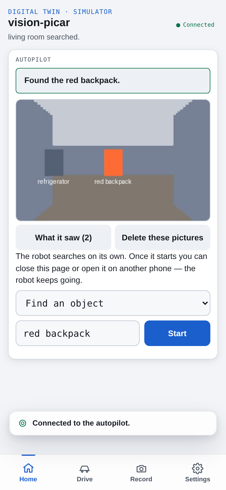

# Rover

**An open-source robot that finds things in your home.**

A Mars rover explores a planet. This one explores your house, and finds what
you ask for.



*The phone app, driving the simulator. The software cannot tell the
simulator from the real robot.*

Say "find my red backpack". Rover drives off, searches the house room by
room, recognises the backpack when it sees it, and stops in front of it.

## What Rover does

* **Finds what you name.** The target is plain words, not a fixed list of
  objects it was trained on.
* **Needs no floor plan.** It maps the house as it drives and decides for
  itself where to look next.
* **Works with the internet unplugged.** Seeing, recognising, mapping and
  planning all run on the robot. The cloud is a last resort, not a
  requirement.
* **Tells the truth about what it found.** It confirms the object before it
  says "found". When it cannot confirm, it says so.
* **Stops when you say stop.** Every movement passes one safety layer, and a
  person's Stop overrides everything else.
* **Runs on hardware you can buy.** An NVIDIA Jetson Orin Nano Super on a
  Waveshare UGV Rover chassis, with a lidar and a depth camera.
* **Is open, all of it.** The code, the simulator and every measurement are
  in this repository.

## Try it in five minutes

No robot, no GPU and no API key needed.

```bash
git clone --depth 1 https://github.com/eldolor/physical-ai-rover.git
cd physical-ai-rover
python3 -m venv .venv && source .venv/bin/activate
pip install -r requirements.txt

uvicorn robot.server:app --port 8000 &
uvicorn control.brain_server:app --port 8001 &
```

Open http://127.0.0.1:8000/ in a browser, narrowed to phone width. Press
**Connect**, then **Start**. Rover searches the simulated house and finds the
red backpack in about 30 seconds. The **Drive** tab shows its camera and the
map it draws as it goes.

To run it again from the start position, restart the robot server.

## How Rover is different

| Other robots | What they do | What Rover does |
|---|---|---|
| Robot vacuums with cameras | Notice some objects they pass while cleaning | Goes looking for the one thing you name |
| Home security robots | Patrol and send video to your phone | Searches for a thing, and works offline |
| Research systems for object search | Run on research robots that cost tens of thousands of dollars | Runs on a hobby chassis and a single-board computer |

## Measured, not promised

Every figure here was held to a pass mark written down before it was
measured. The harnesses that produced them are in `evaluations/`.

| What | Result | Where it was measured |
|---|---|---|
| Naming the right object | 97.2% precision on a 299-frame set, on board | Jetson |
| Time to decide "is this it?" on arrival | 1.9 s at the 90th percentile | Jetson, whole stack running |
| Paid cloud calls | 765 cut to 6 across 21 houses | Simulator |
| Searching a house with no map until the target is reached | 99 of 100 houses | Simulator, imported floor plans |
| Looking at each camera frame | 61 ms typical | Jetson |
| Houses to test in | 4 hand-built, 1,000 imported | Simulator |

## What is next

The first finds in a real home, on the Waveshare chassis, on video. Star the
repository to see it when it lands.

## Get involved

* **Try it** with the five-minute start above, and tell us how it went.
* **Star the repository** to follow along.
* **Open an issue** with a question, a bug or an idea.
* **Send a fix.** [`CONTRIBUTING.md`](CONTRIBUTING.md) says how contributions
  are licensed.

Rover's full name is the Physical AI Autonomous Rover, which is where the
repository's name comes from.

---

## Under the hood

The rest of this page is for engineers: why the problem is hard, how each
part works, and how to work in the code.

## Why this is hard

Finding a named object in an unknown home stacks four hard problems:

* **Open-vocabulary recognition on an edge budget.** The target is free
  text, not a trained class, and homes are full of near-misses: a teal bin
  pulls large cloud VLMs to 68% precision on our identity set. The models
  that discriminate well are multi-billion-parameter VLMs, and the Jetson
  has 8 GB of unified memory shared with detection, SLAM, nav2 and the
  safety loop.
* **Search with no prior map.** With the target out of view, no VLM we
  measured, local or cloud, predicts its direction better than a base-rate
  guess. Where to look has to come from the occupancy map the robot is
  still building.
* **Hard real time beside heavy inference.** The wheel loop runs at 20 Hz
  on a Python event loop that also serves maps and telemetry; one
  synchronous JSON encode is enough to make ticks late.
* **Safety independent of the planner.** nav2, the brain and a person on
  the D-pad all issue motion. None of them may be trusted to be right about
  clearance.

## How it works

### Perception: three tiers, cheapest first

1. **Every frame, on board.** YOLOE-11s-seg proposes open-vocabulary
   crops; CLIP RN50 scores each against the target text and gates at
   P >= 0.8. Median 61 ms, p90 110 ms a frame on the Jetson at 15 W.
2. **Identity, on board.** A candidate goes to Qwen2.5-VL-3B, INT4 AWQ with
   a vocabulary trimmed to 17,920 tokens and FP8 embeddings, built and run
   with TensorRT Edge-LLM behind a local HTTP service. 97.2% precision on
   the 299-frame identity set (the cloud model: 67.9%); 1.32 s p90 with the
   whole stack running; arrival-to-verdict p90 1.91 s.
3. **Escalation to the cloud.** Claude on Amazon Bedrock is asked only
   after repeated "unable" answers from the local tier, or when it is down.
   A lower tier never overrides a higher one's answer.

Across 21 simulated houses the ladder took cloud calls from 765 to 6.
Arrival is geometric as well as visual: the target centred and the lidar
under 0.40 m for two frames before identity is asked. With the cloud
unreachable, an arrival the local tier cannot settle ends
`arrived_unconfirmed`, never `found`.

### Search: SLAM, nav2 and a learned frontier ranker

The D500 lidar feeds **slam_toolbox** (tuned scan-matcher smear: two tours
agree within 4.2 cm in the furnished test house), and **nav2** plans and
follows routes, with `collision_monitor` and `twist_mux` in front of
`ros2_control`'s diff-drive controller. All of ROS 2 lives in one container;
nothing outside it imports `rclpy`, and a capped HTTP bridge is the only
door. The pose graph is saved per mission and reloaded in localisation
mode on the next start.

**Where to look next is learned.** Candidates are the map's frontiers and
unseen patches that the chassis can actually leave; a small network ranks
them on room structure (unentered rooms, doorways, a per-object room
prior), travel distance and the robot's own trail. It is behaviour-cloned from an
oracle with the target's true position, then fine-tuned with **PPO** over
ProcTHOR-10K floor plans. On 588 held-out houses: 14-22% fewer goals than
the hand-written rule, finds within 1%. The full choice is 95 ms p90 on the
Jetson under load, after the grid work was vectorised in numpy with
bit-identical answers.

### Decisions: behavior trees

The tiered policy's three decisions -- what to do this frame, when to ask,
whom to ask -- are **behavior trees** on py_trees (0.85 ms p90 a frame on
the Jetson). Rung order and node parameters are configuration, validated
at load. Invariants stay outside the trees: safety, a person's Stop, the
arrival rule, and who may declare `found`.

### Safety: enforced in one place, on every path

* **Every motion passes `robot/safety.py`** in the robot server: a
  depth-grid cone chosen by body bearing, the chassis' swept corridor off
  the 360-degree scan, a pivot guard, a floor band for objects below the
  lidar, no motion without fresh wheel feedback, and stall detection.
  nav2's `collision_monitor` sits in series before it; the robot server has
  the last word.
* **Arbitration by rank:** `stop > person > brain`, with nav2 goals ranked
  as a driver. A person's Stop latches autonomy out and cancels nav2 goals
  until a new mission starts.
* **Three failsafes for three failures:** the robot watchdog (no command,
  motors stop), the mission runner (stuck vision calls, failure budget),
  the brain server (a tick that never returns).
* **Memory pressure kills the VLM first** (`OOMScoreAdjust=1000`), never
  the robot stack.

### The pieces

```
 phone (digital twin) ──HTTP──┐
                               ▼
 brain  ──────HTTP──────▶  robot server  ──────▶  body: the simulator,
 missions, perception,     safety, who is          or the Rover's ESP32
 behavior trees,           driving, watchdog       motor board and lidar
 local VLM, cloud calls        ▲   │
                               │   ▼ HTTP
                       ROS 2 container:
                       SLAM (slam_toolbox), routes (nav2),
                       velocity arbitration, wheel kinematics
```

* **Brain:** runs the mission and picks each move. It reaches the robot only
  over HTTP, so it runs on a laptop or the Jetson unchanged.
* **Robot server:** safety, arbitration of who is driving, the watchdog.
* **ROS 2:** mapping and route planning from standard packages.
* **Body:** anything that implements one interface, the simulator or the
  real Rover. Switching is a configuration change.
* **Phone app (digital twin):** a D-pad, a live map and mission control. It
  draws what the servers report and decides nothing.

[`docs/ARCHITECTURE.md`](docs/ARCHITECTURE.md) is the whole system on one
page.

## How it is built

* **Simulation first.** The software cannot tell the simulator from the
  car: continuous differential-drive kinematics, sensor noise, moving
  people and pets, and the Rover's ESP32 firmware and LD19 lidar protocol
  emulated on ptys. Four hand-built houses plus 1,000 ProcTHOR floor plans.
* **Data decides.** Every feature has a pass/fail number written down
  *before* it is measured, measured through the real path, and pinned in a
  test.
* **Spec-driven.** Every component has an architecture spec (what and why)
  and an engineering spec (how) that changes in the same commit as the
  code.
* **Built with Claude Code** throughout: about 155,000 lines of Python, a
  thin layer of C++, and a phone UI in plain JavaScript.

## For developers

```bash
python -m venv .venv
source .venv/bin/activate
pip install -r requirements.txt
python -m playwright install chromium          # so the browser UI tests run, not skip
pip install -r requirements-perception.txt     # only for policy "tiered" (YOLOE + CLIP)

pytest tests/ -q                               # no API key needed; every model call is mocked
pytest service/vision_analyze/tests/ -q        # the cloud vision service's own suite
```

**Run the robot and the brain, and drive from the twin:**

```bash
uvicorn robot.server:app --port 8000
uvicorn control.brain_server:app --port 8001
# open http://127.0.0.1:8000/  -> Connect -> Home tab (Start), Drive tab (D-pad, camera, map)
```

Restart the robot server to put the robot back at its start position.

**Start a mission without the page:**

```bash
curl -X POST localhost:8001/mission/start -H 'content-type: application/json' \
     -d '{"target_object": "red backpack"}'
curl localhost:8001/mission/status
curl -X POST localhost:8001/mission/stop        # stops the loop AND the car
curl -X POST localhost:8001/mission/start -H 'content-type: application/json' \
     -d '{"job": "survey"}'                     # no target: map the house, name its rooms
```

**Other entry points:**

| To | Run / read |
|---|---|
| Turn on SLAM and nav2 | `service/slam/README.md` (Docker; `ROBOT_DRIVE=ros WORLD_MODE=ros`) |
| Drive the car's motor code against a fake board | `ROBOT_MODE=hardware SIM_MOTOR_BOARD=fake WORLD_MODE=none bash service/tunnel/restart.sh` (`WORLD_MODE=ros` with the container) |
| Use another house | `SIM_MAP=scaled_house`, `home_first_floor`, `complex_house` or `procthor:val:<0-999>` |
| Add people and pets that move | `SIM_MOVERS=<scenario>` |
| Replay a recorded phone walk through a policy | `python -m tests.demo_replay_mission recordings/<walk> "<target>" --policy tiered` |
| Check both servers' health | `python -m control.health` |
| Reach the local stack from a phone anywhere | `service/tunnel/` (an ngrok domain split by path) |
| Set up the Jetson, run the stack there as systemd services, benchmark it | `tools/jetson/README.md` |

## What is in the repo

| Path | What |
|---|---|
| `robot/` | The robot server, `RobotInterface`, the safety layer, the motor-board and lidar drivers |
| `world/` | `WorldInterface`: pose and map, from the simulator or from SLAM |
| `brain/` | Mission policies, on-board perception, the behavior trees, the goal chooser, the arrival rule |
| `control/` | The brain as a service, failsafes, health, recorded-walk tools |
| `sim/` | The simulator: houses, physics, renderer, movers, the fake motor board and lidar |
| `service/` | The ROS 2 container, the local VLM service, the cloud vision service, deployment and tunnel scripts |
| `firmware/` | Our patch to the Rover's ESP32 firmware (GPL-3.0) |
| `web-twin/` | The phone UI |
| `tools/` | The Jetson's setup and benches, the spec linter, the parallel-session and lock tools |
| `evaluations/` | Measurement harnesses and their recorded results, by plan section |
| `docs/` | Specs (architecture and engineering per component), plans, guides, hardware, evaluations |

## Reading list

| Doc | For |
|---|---|
| [`docs/guides/INTRODUCTION.md`](docs/guides/INTRODUCTION.md) | A non-technical introduction |
| [`docs/ARCHITECTURE.md`](docs/ARCHITECTURE.md) | The system on one page |
| `CLAUDE.md` | Orientation for working in the code: the rules, the current state, the gotchas |
| [`docs/README.md`](docs/README.md) | The index: a spec pair for each component, and the reading path |
| [`docs/plans/PLAN-ros-alignment.md`](docs/plans/PLAN-ros-alignment.md) | The governing plan: every phase, criteria written first, results recorded |
| [`docs/guides/FEATURES.md`](docs/guides/FEATURES.md) | Every feature of the twin, end to end |
| [`docs/guides/AGENT-HARNESS.md`](docs/guides/AGENT-HARNESS.md) | How the brain service works: the tick, seams, failsafes |
| [`docs/hardware/JETSON-BOM.md`](docs/hardware/JETSON-BOM.md) | The hardware: every part and what it cost |

## Licence

Copyright (C) 2026 Anshu Gaind.

This project is licensed under the [GNU AGPL-3.0-only](LICENSE). The ESP32
firmware patch in `firmware/ugv_base_ros/` modifies GPL-3.0 firmware and
stays GPL-3.0. `sim/fake_esp32.py` is GPL-3.0-only because it
reimplements behaviour from Waveshare's GPL-3.0 firmware, and so are its
tests (`tests/test_fake_esp32.py`, `tests/test_ros_driver_board.py` and
`tests/test_firmware_fork.py`), which pin that behaviour. Third-party
parts keep their own licences, listed in
[`THIRD_PARTY_NOTICES.md`](THIRD_PARTY_NOTICES.md). How contributions are
licensed: [`CONTRIBUTING.md`](CONTRIBUTING.md).
