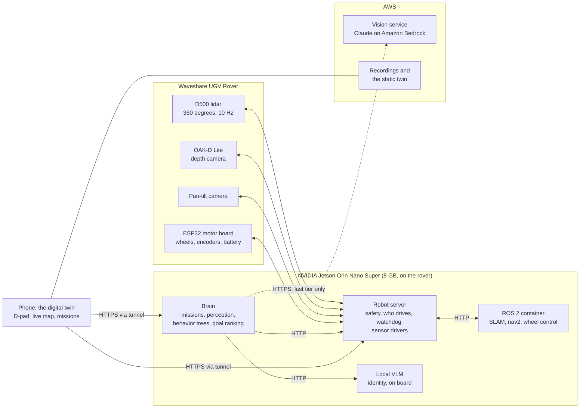
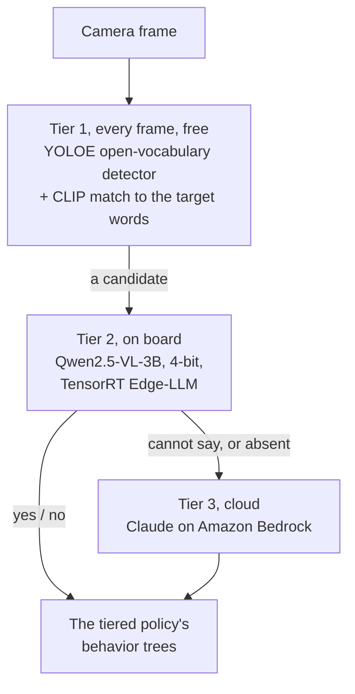
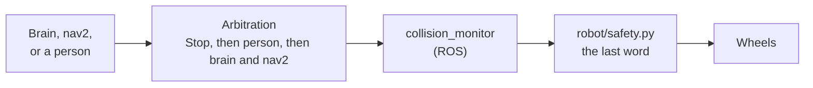
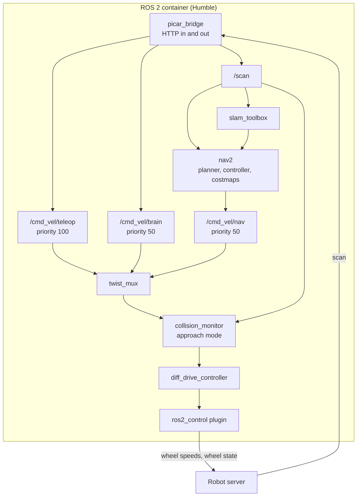

# Architecture overview

The **Physical AI Autonomous Rover** (code name vision-picar) is an indoor
robot that finds a named object in a home it has never been shown. A person
says "find the red backpack"; the rover maps the house as it drives, decides
where to look, recognises the object, confirms it, and stops in front of it.

This page is the target architecture: the system as it is designed to run
on the rover in a home. Each component's own specification sits under
`docs/<domain>/` and is listed in the [index](README.md); the plans in
[plans/](plans/) hold how each part was chosen and every measured number.

## Design principles

1. **Edge first, cloud last.** Perception, identity, mapping, planning and
   safety all run on the rover. A cloud model is the last tier of one
   question, and the rover works with the internet unplugged.
2. **Safety in one place, with the last word.** Every motion, whoever asks
   for it, passes one safety controller in the robot server, after ROS's own
   checks. Safety never depends on a model being right.
3. **The map decides where; models decide what.** Out of view, no vision
   model can say where a target lies, so where to look comes from the map.
   Models answer one question: is this the target?
4. **Cheapest answer first.** Each identity question climbs a ladder of
   models, from free and fast to paid and slow, and stops at the first
   answer it can trust.
5. **Learn only where it is safe to learn.** Learned components rank
   choices the rules already allow. A bad weight makes a search slower,
   never a move unsafe.
6. **ROS for plumbing, not judgement.** Mapping, route planning and wheel
   control come from standard ROS 2 packages, sealed in one container. The
   mission, the models, safety and the person's controls stay outside it.
7. **One body interface.** Everything above the body talks to one contract,
   so the real rover and its simulated double are interchangeable.
8. **A person always wins.** A person's Stop outranks every autonomous
   driver and latches autonomy out until a person starts a new mission.

## The system on one page

| Process | Owns | Never does |
|---|---|---|
| **Robot server** | The body: sensor drivers, the safety veto, who is driving, the watchdog | Plan routes, build maps or judge what it sees |
| **ROS 2 container** | SLAM, route planning (nav2), velocity arbitration, wheel kinematics | Touch the body except through the robot server |
| **Brain** | The mission: perception every frame, the decisions, where to look next, the arrival rule, its failsafes | Touch the body except over HTTP |
| **Local VLM** | One question: does this frame show the target? Asked first, every time | Drive, steer, or keep anything safe; it is the first process killed when memory runs out |
| **Vision service** (cloud) | The last tier of the identity question, and room names on request | Run unless the tiers below it cannot answer |
| **Phone (the twin)** | Drawing what the servers report; the D-pad; starting and stopping missions | Decide anything |

## The walls

Four boundaries keep the system honest, and each is enforced by a test.

1. **One abstraction for the body: `RobotInterface`.** The brain, the robot
   server and ROS never know whether they drive the rover's motor board or
   the simulator. One factory chooses, from configuration, and one
   conformance suite runs against every backend.
2. **Body state and world state are separate.** Odometry is what the body
   says about itself; pose and map are what the world says about the body
   (`WorldInterface`). SLAM's pose may jump when the map corrects itself;
   odometry never does.
3. **ROS stays inside its container.** Nothing outside it imports ROS;
   everything talks to it over one HTTP bridge with a capped set of routes.
4. **Safety sits in series, with the robot server last.** ROS's
   `collision_monitor` checks every command, then `robot/safety.py` does.
   Each can only slow or stop, never speed up, so they cannot disagree
   about what is allowed. The serial port to the motor board belongs to the
   robot server alone, so no path reaches the wheels around it.

### Where the line is

Robotics plumbing belongs inside ROS: solved problems where ROS's packages
beat anything the project would write. Everything that makes this robot
this robot stays outside, plus the one piece that must keep working when
ROS hangs.

| Piece | Side of the line |
|---|---|
| Wheel control, odometry, SLAM, route planning | Inside ROS |
| Lidar, camera and motor-board drivers | Outside, in the robot server, so safety keeps its sensors when ROS hangs |
| Safety veto, arbitration, watchdog | Outside, in the robot server, always |
| Perception, identity, decisions, goal ranking | Outside, in the brain and the local VLM |
| The phone | Outside, over HTTP |

## Perception and identity: a ladder of models

- **Tier 1** proposes and scores every frame on the Jetson's GPU. It may
  steer the rover toward a candidate; it never declares a find.
- **Tier 2** answers the identity question for a candidate and at arrival.
  Its precision is the reason the cloud is rarely needed.
- **Tier 3** is asked only when the local model cannot say, or is not
  running. A lower tier never undoes a higher tier's answer, and a "no" is
  remembered until the rover has moved or turned enough to see anew.

**Arrival** is geometric before it is visual: the target centred and the
lidar, never the detector, reading it within 0.40 m on consecutive frames.
Only then is identity asked, and only a trusted "yes" ends a mission
`found`.

## Search: the map decides where to look

The lidar feeds **slam_toolbox**, which builds the map and keeps the rover
on it; **nav2** plans and follows routes across it. The brain's explore
search turns the map into candidate places to go: frontiers between known
and unknown space, and patches the camera has not yet seen, each one a
place the chassis can drive into and out of again.

A **learned goal ranker** chooses among them. It reads the map's structure
(unentered rooms, doorways, a prior over which rooms an object lives in,
travel distance, the rover's own trail), and was trained in two stages:
cloned from an oracle that knows where the target is, then refined with
reinforcement learning (PPO) over a thousand floor plans, rewarded for
finding the target in fewer goals and metres. It ranks; the rules decide
what is allowed.

When the target is in view, explore closes in on it, and the identity
ladder decides whether it is the target.

## Decisions: behavior trees

The tiered policy's three decisions are behavior trees (py_trees): what to
do this frame, when to ask a model, and which model to ask. The order of
the tiers and each node's parameters are configuration, validated at load.

The rules that must never bend sit outside the trees, where no setting
reaches: safety, a person's Stop, the arrival rule, who may declare
`found`, and the failsafes.

## Safety

- **Arbitration by rank.** Every command names its driver. A Stop outranks
  a person, a person outranks the brain and nav2, and authority lapses on
  silence, so there is no release to forget. A person's Stop latches
  autonomy out: the brain's moves and goals are refused until a person
  starts a new mission. A person's move also ends any live nav2 goal.
- **The veto, in series.** A depth-camera cone along the body's heading;
  the chassis' swept corridor against the 360-degree scan; a pivot guard
  for turns that would swing a corner into something; and the depth
  camera's floor band for objects below the lidar's plane. The stopping
  distance follows the speed asked for. A detector may steer, but only
  measurement vetoes.
- **The body's own state.** No wheel moves without fresh wheel feedback,
  and a stalled wheel stops.
- **Three failsafes, kept apart.** The robot server's watchdog stops the
  wheels after a second without a command; the mission runner bounds a
  stuck model call and counts failures; the brain server catches a tick
  that never returns. Each sees a failure the others cannot. Below them,
  the motor board's own heartbeat stops the wheels if the Jetson goes
  silent.

## One move, end to end

A person's tap on "forward" crosses the process boundary four times and
repeats its middle steps 20 times a second until the encoders say the move
is done.

1. **Phone** posts the verb to the robot server, naming itself as the
   driver.
2. **Robot server, arbitration.** A person outranks the brain, so a running
   mission is told it was preempted, and any live nav2 goal ends.
3. **Robot server, safety.** The cone, the swept corridor and the floor
   band are checked; anything inside the stopping distance refuses the
   move, with a reason.
4. **`ros_drive`** reads the encoders, works out how far is left, and sends
   a velocity to the bridge, ramping down as the target nears because the
   chain has 40-150 ms of variable delay.
5. **The bridge** publishes it on the person's command topic.
6. **`twist_mux`** ranks it against the brain's and nav2's topics;
   **`collision_monitor`** slides the footprint along the motion and slows
   anything that would hit, while still allowing turns away from a wall.
7. **`diff_drive_controller`** turns the twist into two wheel speeds.
8. **The ros2_control plugin** posts them to the robot server as driver
   `ros`, the only driver allowed to write the wheels.
9. **Robot server, last word.** `robot/safety.py` clamps speed near an
   obstacle and slows a turn that would swing a corner into something; a
   20 Hz loop keeps re-checking while the command stands. The motor board
   drives the wheels.
10. **Done.** When the encoders agree, a zero twist, a settle, an overshoot
    correction, and the answer to the phone.

If anything goes quiet along the way, something stops the wheels:
`twist_mux` and the controller within 0.5 s, the watchdog after 1 s, the
motor board's heartbeat after that.

## Inside the ROS container

- **Commands** arrive on one topic per kind of driver, so `twist_mux` ranks
  them in the same order the robot server does; a linter checks the two
  agree.
- **`collision_monitor`** runs in approach mode, not a stop zone: a stop
  zone would freeze the rover against a door jamb, because "stop" blocks
  turning away too.
- **The ros2_control plugin** is a thin adapter to the robot server over
  HTTP, the only C++ in the robot. The body behind the robot server is
  what changes, never the plugin.
- **The TF tree** has one owner per link: the URDF for the fixed parts,
  the controller for `odom` to `base_link`, SLAM for `map` to `odom`. The
  gap between `map` and `odom` is exactly the drift SLAM has corrected.

## The map

The same map exists in three forms, and only the last crosses the wall.

| Layer | Form | Read by |
|---|---|---|
| SLAM's own | A pose graph: places the rover stood and their scans, linked by scan matches and loop closures | `slam_toolbox` |
| ROS | An occupancy grid: 5 cm cells, unknown or 0-100 certainty | nav2 |
| This project's | Unknown, free or occupied cells in the house frame, with a map id and version | The brain, the phone |

The grid is tri-state on purpose: unmapped must never look like empty
floor. It crosses the bridge only when it has changed.

**The map persists.** The pose graph is saved at every mission end, in
versions. The next start localises on the saved map from the dock, checks
the scans against it, and falls back to a fresh map if they disagree. Space
the saved map calls unknown is mapped again on entry, or on a person's
request. Goals wait until SLAM and nav2 are ready, and the bridge says
which it is waiting for. Each mission's object inventory (labels and
positions, never images) carries to the next mission on the same map. A
map is a home's floor plan, so it never leaves the rover unasked.

## Budgets

The Jetson's 8 GB is shared by CPU and GPU, and everything lives inside it.

| Resource | Budget | Why |
|---|---|---|
| Wheel and safety loop | 20 Hz, no late tick | Every motion is re-vetted while it stands |
| Perception, tier 1 | 250 ms a frame | Steering on a stale frame drives into the past |
| Goal choice | 100 ms | Explore's choice sits inside the mission tick |
| Arrival to identity verdict | 2 s | The rover is stopped, waiting |
| Free memory | 500 MB floor | Below it the local VLM is killed first, never the robot stack |
| Cloud calls | A last resort | Paid, slow, and absent offline |

Two rules keep the timing: a large reply is never encoded on the robot
server's event loop, and the map crosses the bridge only when it changed.

## Degraded modes

| What fails | What the rover does |
|---|---|
| The cloud | Searches on; identity from the local VLM. An arrival only the cloud could settle ends `arrived_unconfirmed`, never `found`, and is confirmed late when the cloud returns |
| The local VLM (killed or absent) | Its questions go to the cloud |
| ROS | Direct drive: the robot server runs verbs straight through the safety veto; only a person may drive |
| The brain hangs | The watchdog stops the wheels; the brain server ends the tick |
| The Jetson goes silent | The motor board's heartbeat stops the wheels |
| Wheel feedback | No motion until it returns |
| The phone or the tunnel | The mission continues; the twin only observes |
| The battery | The mission ends `out_of_budget` at the floor |

A mission ends `found`, `exhausted` (nowhere reachable left to look),
`out_of_budget` (time or battery) or `cancelled` (a person stepped in),
each with a report. A **survey** is a mission with no target that maps the
house and names its rooms.

## Off the rover

- **Vision service** (AWS Lambda over Amazon Bedrock): the cloud tier of
  identity, and room names on request. Free health checks tell the brain
  when the cloud is back.
- **The twin** is static on S3 and CloudFront and reaches the rover through
  one tunnel, split by path between the robot server and the brain, behind
  a shared secret.
- **Recordings** (S3): recorded walks, their scores, and mission
  inventories (labels and positions only). Maps stay on the rover.
- **On the rover**, systemd starts everything at boot: the robot stack
  (protected from the out-of-memory killer), the tunnel, and the local VLM
  (the first process it kills).

## The simulator

The simulator is the rover's double behind the same `RobotInterface`: a
continuous differential-drive body with sensor noise, people and pets that
move, the motor-board firmware and the lidar's serial protocol emulated on
ptys so the rover's own drivers run, four hand-built houses and a thousand
imported floor plans. Every behaviour is proven there, against ground truth
no real house can offer, before it runs on the rover.

## Specs

[body](body/ARCHITECTURE.md), [world](world/ARCHITECTURE.md),
[safety](safety/ARCHITECTURE.md), [ros](ros/ARCHITECTURE.md),
[mission](mission/ARCHITECTURE.md), [policy](policy/ARCHITECTURE.md),
[perception](perception/ARCHITECTURE.md),
[cloud-vision](cloud-vision/ARCHITECTURE.md),
[platform](platform/ARCHITECTURE.md),
[motor-board](motor-board/ARCHITECTURE.md),
[simulator](simulator/ARCHITECTURE.md), [twin](twin/ARCHITECTURE.md),
[control-api](control-api/ARCHITECTURE.md),
[recordings](recordings/ARCHITECTURE.md),
[operations](operations/ARCHITECTURE.md).
